# Website Hosting on AWS EC2 Using Apache

**Project Type:** Cloud Computing / Linux Administration  
**Created by:** Tulasi S.

## 1. Project Overview

This project demonstrates how to host a static website on an Amazon Web Services (AWS) EC2 instance using Amazon Linux and the Apache HTTP Server.

It covers launching a cloud-based Linux server, configuring network access, connecting remotely, setting up Apache, creating a webpage, and checking that the website is accessible.

## 2. Project Objectives

- Understand the fundamentals of AWS EC2.
- Launch and manage a Linux virtual machine in AWS.
- Configure inbound network access using a Security Group.
- Connect to a remote Linux server using SSH.
- Install and manage the Apache HTTP Server.
- Host a static webpage on an EC2 instance.
- Verify website access through a web browser and connectivity testing.

## 3. Technologies and Tools

| Technology / Tool | Purpose |
|---|---|
| Amazon Web Services (AWS) | Cloud platform |
| Amazon EC2 | Virtual server |
| Amazon Linux 2023 | Server operating system |
| Apache HTTP Server | Web server |
| SSH | Secure remote server connection |
| HTML | Webpage content |
| Wget | Connectivity testing |

## 4. Project Implementation

### Step 1: EC2 Instance Creation
Created an EC2 instance in AWS and selected Amazon Linux as the operating system.

### Step 2: Security Group Configuration
Configured inbound access for remote administration and website traffic. SSH uses port 22 and HTTP uses port 80.

### Step 3: Remote Server Connection
Connected to the EC2 instance remotely using SSH.

### Step 4: Apache Web Server Setup
Installed the Apache HTTP Server on the Linux instance.

### Step 5: Apache Service Management
Started the Apache service and configured it to start automatically when the server boots.

### Step 6: Website Setup
Created a static HTML webpage and placed it in the Apache web server's document directory.

### Step 7: Website Access and Testing
Accessed the website using the EC2 instance's public IPv4 address and checked connectivity.

## 5. Project Architecture

**User / Web Browser → Internet → AWS Security Group → EC2 Instance → Apache Web Server → Static HTML Website**

## 6. Project Screenshots

The following screenshots are included in the `screenshots` folder of this repository.

### 1. EC2 Instance
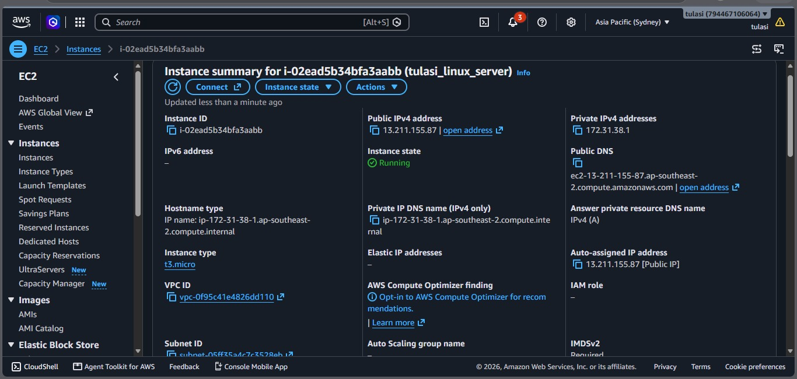

### 2. Security Group
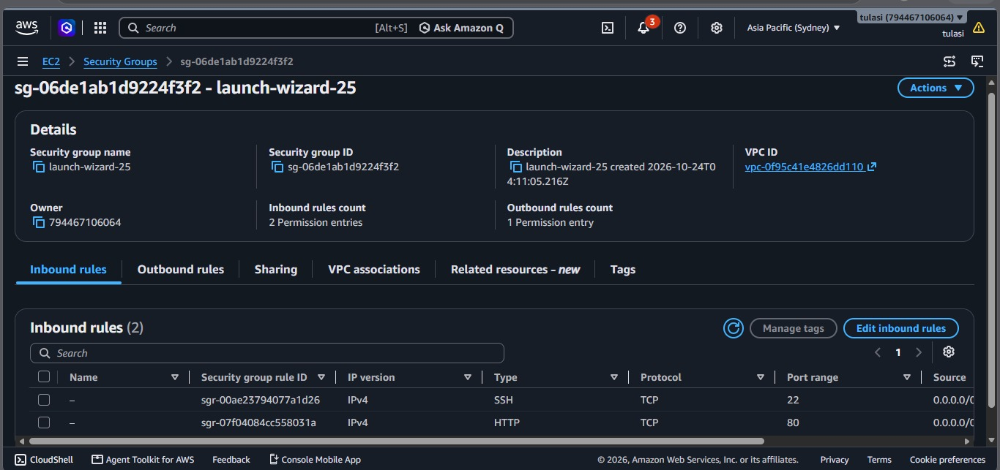

### 3. SSH Connection
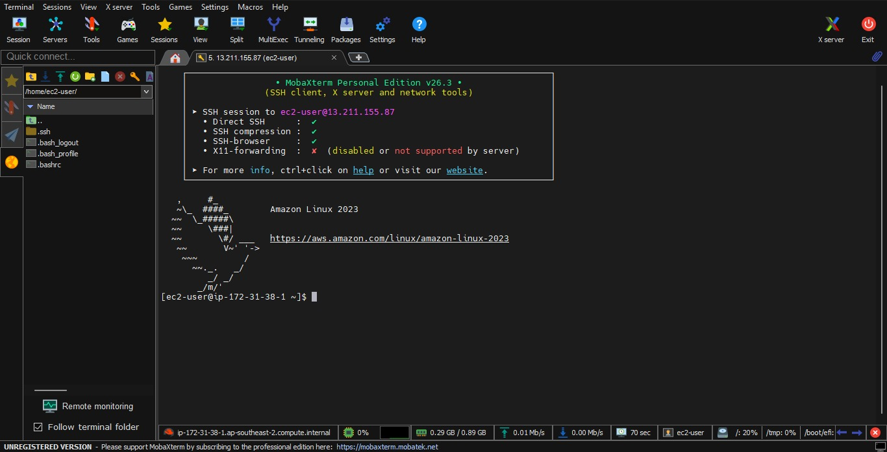

### 4. Linux Server
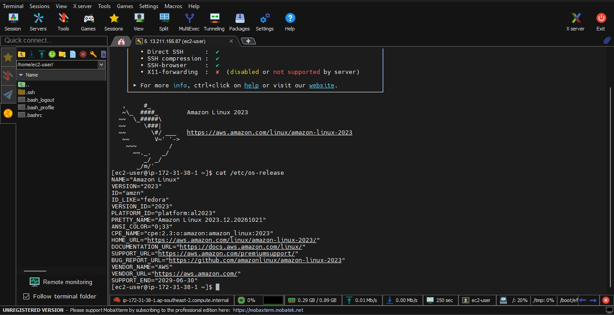

### 5. Apache Setup
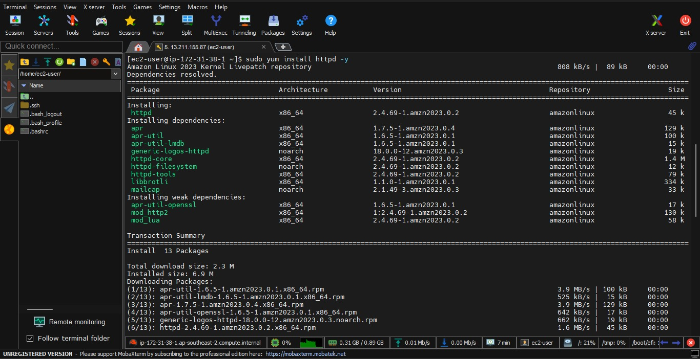

### 6. Server Configuration
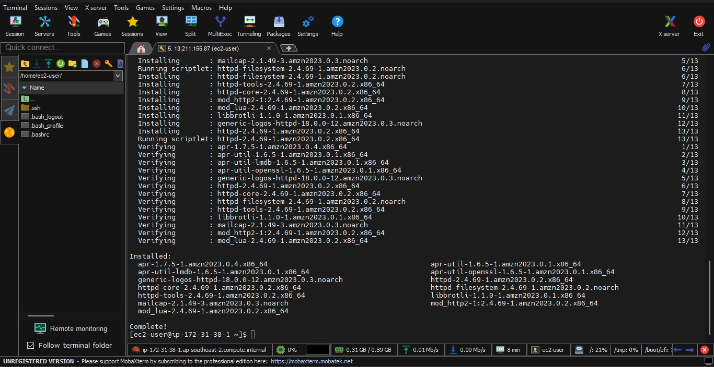

### 7. Apache Verification
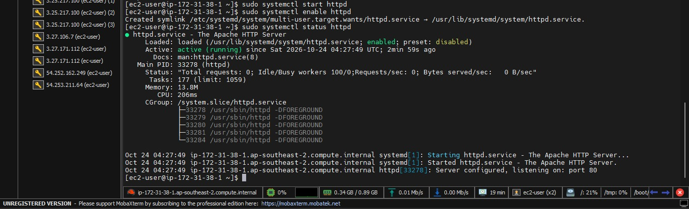

### 8. Website Configuration
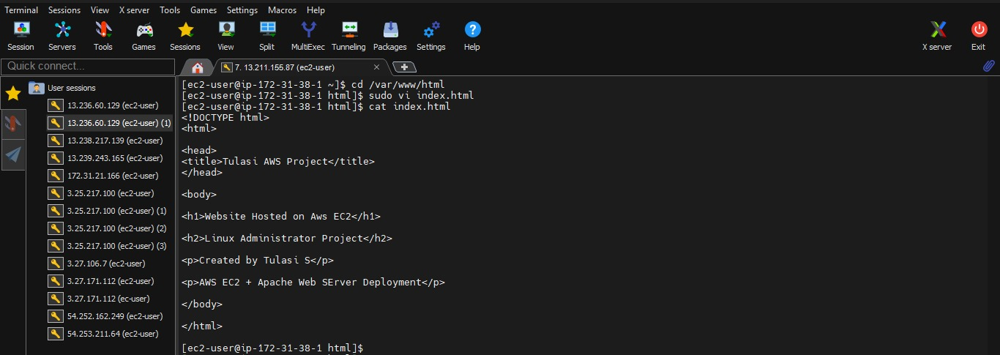

### 9. Hosted Website
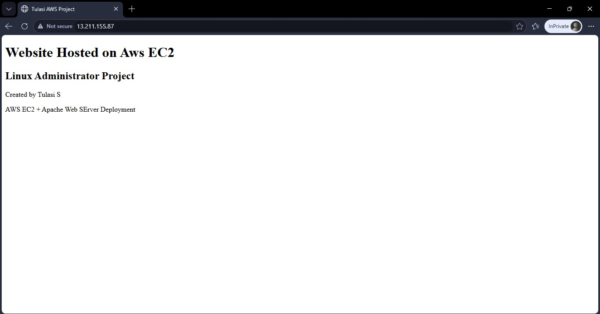

### 10. Wget Testing
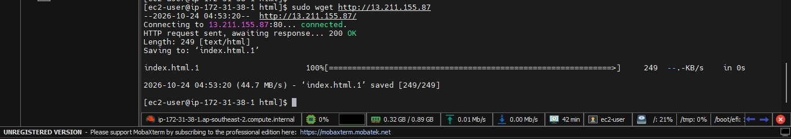

### 11. Network Verification
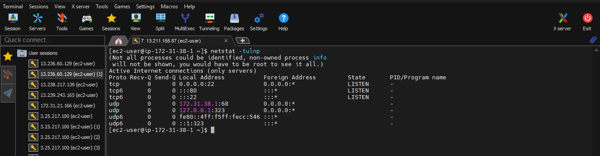

## 7. Skills Demonstrated

- AWS EC2 instance management
- Linux server administration
- Security Group configuration
- SSH connectivity
- Linux package and service management
- Apache web server setup
- Basic HTML website hosting
- Website and network connectivity testing

## 8. Conclusion

This project provided practical experience in launching and managing a Linux server on AWS EC2 and hosting a static website using Apache. It strengthened my understanding of cloud infrastructure, Linux administration, basic web hosting, and network access configuration.

## 9. Author

**Tulasi S.**  
Linux | AWS | CCNA | DevOps
